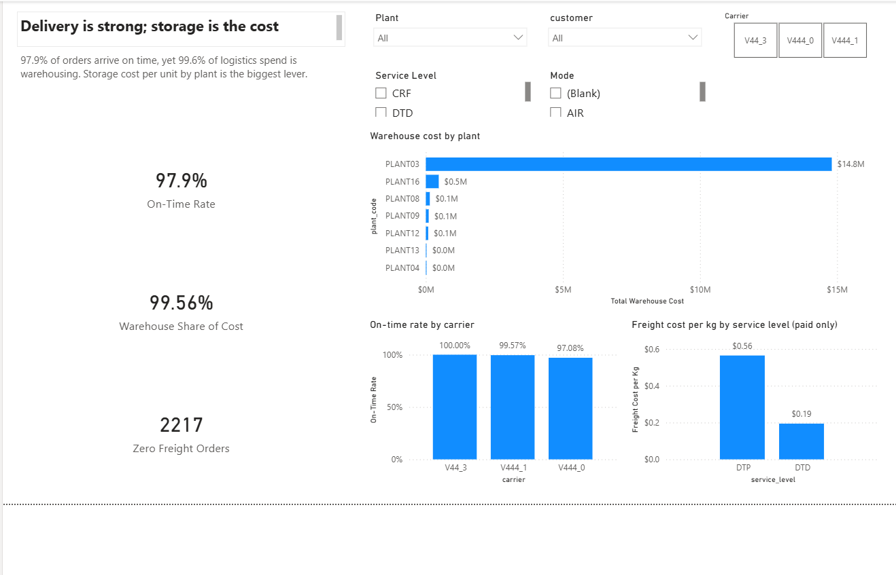
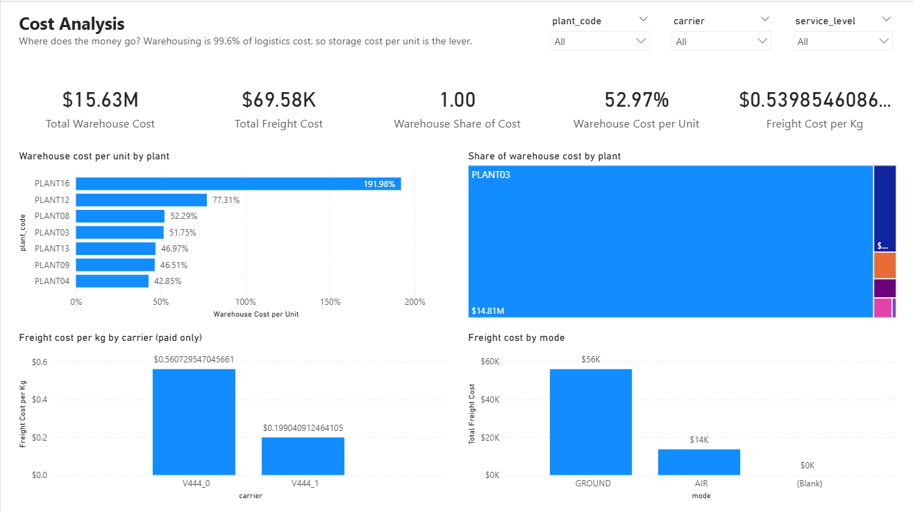
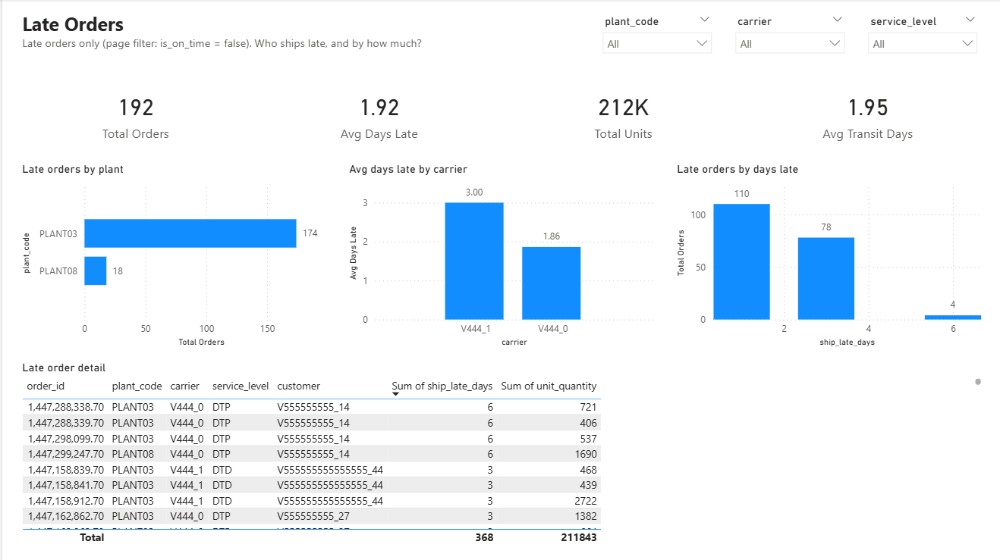

# Brunel Supply Chain — Order KPI Report (Power BI)

An executive Power BI report on outbound order performance for a multi-plant supply chain network. It measures delivery reliability, freight and warehouse cost, and customer-arranged shipping across **9,212 orders** and **29.5M units**. The report turns those measures into findings and recommendations.

**Headline finding:** Delivery is strong (97.9% on-time, 52% shipped early), but **99.6% of total logistics cost is warehousing, not freight**. Storage cost per unit by plant is the biggest lever.

---

## Business Questions

- How reliable is delivery across plants, carriers, service levels, and shipping modes?
- Where does logistics spend go: freight or warehousing?
- Which plants are expensive to store product in?
- How much volume ships on customer-arranged freight (CRF), and how does that distort cost-per-kg metrics?

---

## Dataset

| Attribute | Detail |
|---|---|
| **Source** | Brunel University London — [Supply Chain Logistics Problem](https://doi.org/10.17633/rd.brunel.7558679.v2) (CC BY 4.0) |
| **Scope** | 9,212 orders, all dated 26 May 2013 (single-day snapshot — no time-trend analysis) |
| **Dimensions** | 7 plants · 3 carriers · 3 service levels · 3 shipping modes · 46 customers |

---

## Tools and Pipeline

```
Raw Brunel files ──► PostgreSQL (cleaning, joins, kpi views) ──► Power BI (model, DAX, report)
```

| Layer | What it does |
|---|---|
| **PostgreSQL** | Loads raw tables, joins orders to freight and warehouse rates, flags on-time / early / CRF / quantity outliers, and exposes `kpi.*` views |
| **Power BI** | Imports the `kpi` views, builds a star-style model, and calculates every KPI as a DAX measure |

---

## SQL Scripts

All scripts live in `Brunel_Supply_Chain/` and run in order via `psql`.

| Script | Purpose |
|---|---|
| `load_brunel.sql` | Creates the `supply_chain` database, defines the `brunel` schema, and bulk-loads all seven source CSVs |
| `load_data_only.sql` | Re-loads data only (skips schema recreation) — useful for a clean refresh without dropping structure |
| `clean_brunel.sql` | Builds the `clean` schema: trims padding, deduplicates freight rates, isolates zero-weight exceptions, and adds analysis flags (`is_crf`, `is_zero_transit`, `is_qty_outlier`) |
| `kpi_brunel.sql` | Creates the `kpi` schema with five views consumed directly by Power BI |
| `brunel_view_kpi_views.sql` | Standalone version of the KPI views — same logic, no `\set` psql directives, safe to run in pgAdmin |

### kpi views

| View | Description |
|---|---|
| `kpi.order_costs` | One row per order with computed freight and warehouse cost — the fact table |
| `kpi.summary` | Headline KPIs in a single row |
| `kpi.by_carrier` | Cost, on-time rate, and transit days by carrier and service level |
| `kpi.by_plant` | Warehouse cost and capacity utilization by plant |
| `kpi.by_service_level` | Order mix and on-time rate by service level |
| `kpi.top_customers` | Customer concentration by units shipped |

---

## Data Model (Power BI)

`kpi.order_costs` is the fact table. The summary tables connect many-to-one, single direction:

| From (many) | Key | To (one) |
|---|---|---|
| `kpi order_costs` | `plant_code` | `kpi by_plant` |
| `kpi order_costs` | `service_level` | `kpi by_service_level` |
| `kpi order_costs` | `customer` | `kpi top_customers` |
| `kpi by_carrier` | `service_level` | `kpi by_service_level` |

All slicers and measures read from `kpi order_costs`, so every visual filters consistently. The pre-summarized tables are used for reference only — their stored totals do not respond to slicer selections.

---

## KPI Definitions (DAX)

All measures live in a dedicated `_Measures` table.

| KPI | Definition | Value |
|---|---|---|
| Total Orders | `COUNTROWS('kpi order_costs')` | 9,212 |
| Total Units | `SUM(unit_quantity)` | 29.5M |
| On-Time Rate | Orders where `is_on_time` ÷ Total Orders | 97.9% |
| Shipped Early Rate | Orders where `is_shipped_early` ÷ Total Orders | 52.0% |
| Avg Days Late | Average `ship_late_days` for late orders only (192 orders) | 1.9 |
| Avg Transit Days | `AVERAGE(transit_days)` | 1.7 |
| Total Freight Cost | `SUM(freight_cost)` | $69.6K |
| Freight Cost per Kg | Freight ÷ weight, paid shipments only | $0.54 |
| Total Warehouse Cost | `SUM(warehouse_cost)` | $15.6M |
| Warehouse Cost per Unit | Warehouse cost ÷ Total Units | $0.53 |
| CRF Rate | Orders where `is_crf` ÷ Total Orders | 9.3% |
| Warehouse Share of Cost | Warehouse ÷ (Warehouse + Freight) | 99.6% |
| Zero Freight Orders | Orders with `freight_cost = 0` | 2,217 |

> **Note on Freight Cost per Kg:** 2,217 orders carry $0 freight, mostly customer-arranged shipments (CRF). Including their 54K kg drops the rate to $0.38/kg. The report uses **$0.54/kg** (paid shipments only) because it reflects what the company actually pays to move a kilogram.

---

## Validation

Every KPI was recalculated independently with DAX queries against the live model and compared to the report measures. All values match. The only definitional difference found (freight cost per kg) is documented above.

---

## Featured Dashboards

### Executive Summary
*What's the story in one screen?*
Three insight cards (97.9% on-time, 99.6% of logistics cost is warehousing, 2,217 zero-freight orders) with supporting charts. PLANT03 alone carries $14.8M of warehouse cost.



### Cost Analysis
*Where does the money go?*
Warehouse vs freight spend and unit economics: warehouse cost per unit by plant, each plant's share of warehouse cost, freight cost per kg by carrier (paid shipments only), and freight cost by mode.



### Late Orders
*Who ships late, and by how much?*
Filtered to the 192 late orders: 174 of them come from PLANT03, and carrier V444_1 averages 3 days late against 1.9 for V444_0. Includes an order-level detail table.



The report also has pages on delivery performance, plants, carriers, customers, CRF shipments, lanes and products.

**Interactivity:** synced slicers for Plant, Carrier and Service Level. Cross-filtering between charts.

---

## Key Findings

- **Delivery reliability is high.** 97.9% of orders arrive on time and over half ship early. Late orders average under 2 days late.
- **Warehousing dominates cost.** $15.6M in warehouse cost vs $69.6K in freight. Optimizing storage, not shipping, is where savings are.
- **Customer-arranged freight skews unit economics.** 9.3% of orders are CRF and 2,217 orders show $0 freight. Cost-per-kg metrics must exclude them to be meaningful.

---

## Repository Structure

```
Brunel_Supply_Chain/
├── load_brunel.sql              # Step 1: create DB, define schema, load CSVs
├── load_data_only.sql           # Step 1b: data-only reload (skip schema)
├── clean_brunel.sql             # Step 2: build clean schema with flags
├── kpi_brunel.sql               # Step 3: build kpi views (psql)
├── brunel_view_kpi_views.sql    # Step 3b: kpi views (pgAdmin-safe)
├── FreightRates.csv
├── OrderList.csv
├── PlantPorts.csv
├── ProductsPerPlant.csv
├── VmiCustomers.csv
├── WhCapacities.csv
└── WhCosts.csv

powerbi_dashboards/
└── brunel_kpi_layout_v1.pbix   # Power BI report

images/                          # Dashboard screenshots used in this README
```

---

## How to Open

1. Install [Power BI Desktop](https://powerbi.microsoft.com/desktop/) (free, Windows).
2. Open `powerbi_dashboards/brunel_kpi_layout_v1.pbix`.
3. Data is imported into the file — no live database connection needed to view it.
4. To refresh: point the data source at a PostgreSQL instance with the `kpi` views loaded.
